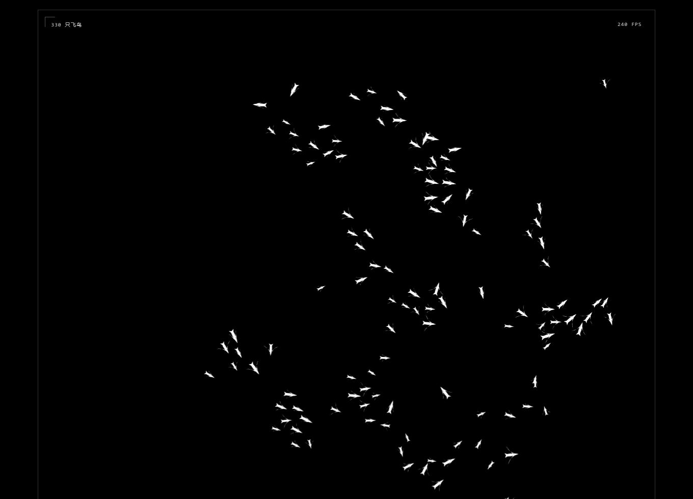

# 向风成群 · 鸟群实验

黑色天空中的白色鸟群。通过分离、对齐、聚合三条局部规则，观察群体如何飞行和避让。

[打开在线演示](https://zyjyzjzyj60.github.io/bird-flock-study/)



## 操作

- 分离：靠得过近时相互避让，默认强度 1.8。
- 对齐：向邻居的平均速度和方向靠近，默认强度 1.0。
- 聚合：朝邻居中心转向，默认强度 0.8。
- 三个滑杆都可调至 0；暂停可以停住画面，重置会恢复默认强度并重新生成鸟群。
- 鼠标进入画布时出现危险圈，附近的鸟会逃离；触屏按住并拖动时启用，松手或取消后消失。手机可从画布两侧留白上下滚动。
- 系统启用“减少动态效果”时初始暂停，可以手动播放。

桌面 330 只鸟，画布宽度小于 640 像素时为 210 只。画布高度是初版的四倍，飞行速度是初版的三倍（速度范围 165–375 CSS 像素/秒）。页面显示实测 FPS，自动调整绘制精度，适配屏幕刷新率。

页面在浏览器中运行，无需摄像头、识别、音源或账号，也不保存设置。

## 本地运行

需要 Node.js 24 和 npm。

```sh
npm ci
npm run dev
```

打开终端显示的 `/bird-flock-study/` 地址。`npm run build` 生成 `dist/`，`npm run preview` 可预览生产版本。

## 验证

`npm test` 运行 12 项单元测试，覆盖三条规则、跨网格邻居、重叠分离、高速回转、天敌避让、330/210 只鸟的稳定性、刷新率无关的速度及自适应绘制精度。

浏览器检查复用本机已有的 Playwright 和 Chrome，不增加项目依赖：

```powershell
$env:BIRDS_PLAYWRIGHT = '已安装的 Playwright 包目录'
$env:BIRDS_PAGE_URL = 'http://127.0.0.1:4173/bird-flock-study/'
$env:BIRDS_STANDALONE = '1'
npm run check:browser
```

检查桌面与手机尺寸、四块画布的连续绘制、黑白像素、滑杆、暂停重置、跨画布危险圈、触屏拖动和滚动、减少动态效果，以及摄像头请求和页面错误。结果写入 `artifacts/`。

2026-10-13 在 Windows、Chrome、240 Hz 屏幕上，以 1360 × 980 窗口测试：初版 110 只鸟、660 像素高画布约 240 FPS；新版 330 只鸟、2640 像素高画布仍约 240 FPS。DPR 1 和 2 均测量 6 秒；DPR 2 时新版自动调整实际绘制密度。原始数据见 [修改前](docs/performance-before.json)和[修改后](docs/performance-after.json)。帧率随设备、浏览器和页面负载变化。手机交互来自 Chrome 触屏模拟，尚未在实体手机实测。

## 部署与代码

推送 `main` 会运行单元测试、生产构建并部署 GitHub Pages。Vite 的 `base` 为 `/bird-flock-study/`；换仓库名称时需要同步修改。

`src/birds/flock.ts` 负责纯模拟与空间网格邻居搜索，`renderer.ts` 将同一世界分成四块连续画布并只重绘视口附近的区域，`frame-monitor.ts` 根据实际刷新周期调整像素密度，`main.ts` 负责交互和生命周期。

当前未添加许可证。
